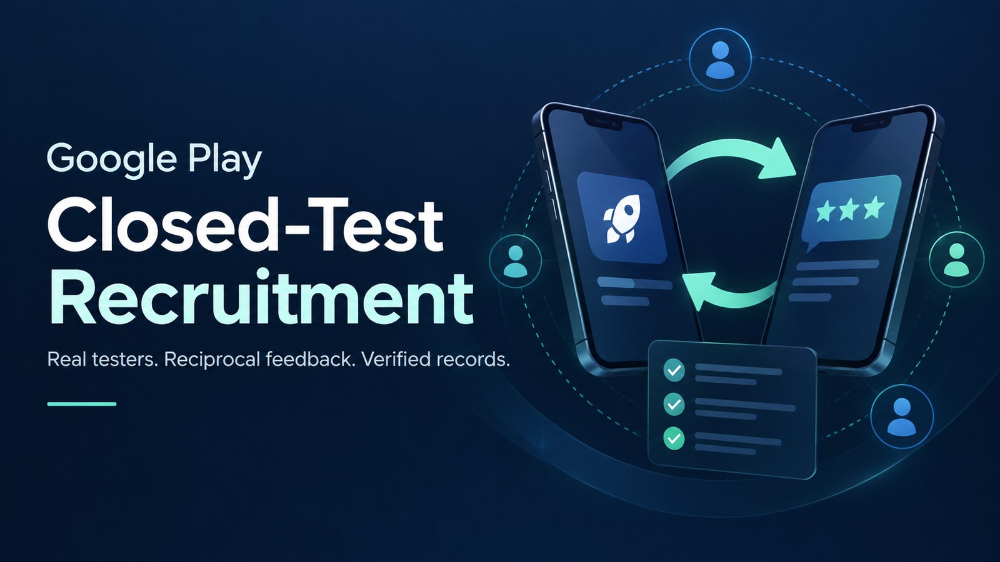

# Google Play Closed-Test Recruitment



An evidence-based agent skill for Android developers recruiting genuine closed-test participants and coordinating one-for-one test exchanges through Google Groups and Reddit.

**Recommended: GPT-powered Codex.** Partial practical validation was performed there. Claude is untested; experiment and configure its tools independently. This workflow does not install tools or guarantee recruitment, continuous participation or approval.

## What it does

- Understand your app and test goals before outreach.
- Find suitable developers and deduplicate contacts by author.
- Separate invitations, agreements, membership, Play opt-in, installation, launch and functional trials.
- Use an authorized real Android device for limited testing, clean screenshots and specific feedback.
- Schedule read-only incremental checks at your chosen interval and model cost; review new contacts before sending.
- Maintain private local evidence and explicit human tasks for sustained use, fixes and retesting.
- After every round, organize communication summaries, each side's testing progress, evidence-based totals and next-action owners in private tables.

## Installation

Download the current package from the [latest release](https://github.com/peikuo/play-closed-test-recruitment/releases/latest), or use one of the methods below. Versioned releases are fixed snapshots; upgrading requires installing the newer package.

Use the skills CLI (third-party install telemetry is enabled by default; set `DISABLE_TELEMETRY=1` to opt out):

```bash
npx skills add peikuo/play-closed-test-recruitment --skill play-closed-test-recruitment --agent codex
```

Or clone the complete skill directory. Compare and back up an existing installation before replacing it:

```bash
git clone https://github.com/peikuo/play-closed-test-recruitment.git ~/.codex/skills/play-closed-test-recruitment
```

Example:

```text
Use $play-closed-test-recruitment to help recruit closed-test participants.
First understand my app and test goals, then check tools and authorization.
Let me choose the monitoring interval; record installation and actual use separately.
```

Ordinary GPT chat may lack skill loading, browser/device control and scheduling. Claude Code users should follow current host installation instructions; no Claude end-to-end verification is claimed.

## Required capabilities

| Task | Tools |
|---|---|
| Product understanding and records | Relevant file reads and private local writes |
| Public recruitment and policy | Web search/read |
| Groups, comments, chats and Console | Authorized signed-in browser or suitable connector |
| Installation, launch, screenshots and trial | Connected authorized real Android device, such as ADB |
| Scheduled checks | Host scheduler and an executor with required environment access |

Missing capabilities limit work to analysis, drafts or manual guidance. The user chooses monitoring interval, scope and notification conditions; supported lower-cost models can handle incremental checks.

## Supported websites

Google Groups; Reddit's AndroidClosedTesting, AndroidAppTesting and TestersCommunity communities; authorized Reddit chats; specific Play opt-in/store pages; read-only access to your own Play Console; and official Google Play developer help. See [website boundaries and compatibility](references/tools-and-compatibility.md). This list is neither blanket action permission nor a network sandbox.

## Privacy and human participation

The package contains generic instructions and an anonymized case, not contact lists, member emails, private chats, screenshots or dashboard records. Keep runtime records in a selected private local directory outside public repositories/cloud sync. Inspect and sanitize screenshots before sending and minimize model inputs; online models are not offline execution. Never consent to private-data uploads or click payment/destructive controls during tests. Across all communities, review new outreach with the user, avoid repeated or unsolicited bulk contact, and stop on moderation restrictions.

Users connect devices, handle verification/agreements/sensitive permissions, and perform sustained natural use and subjective assessment. AI short trials do not replace those tasks. No rating exchanges, fabricated tests, mass outreach, release configuration changes or approval guarantees.

## Structure

```text
SKILL.md
agents/openai.yaml
references/
  tools-and-compatibility.md
  coordination.md
  progress-summary.md
  participation-audit.md
  device-testing.md
  monitoring.md
  case-study.md
```

Start with [SKILL.md](SKILL.md). Load references as needed. `agents/openai.yaml` supplies Codex UI metadata only.

## Validation and limitations

The initial instructions received structure/privacy checks and independent Astra review, with key scenarios examined. Practical experience covers recruitment, eligibility coordination, partial device trials, feedback and scheduling. The English revision preserves those boundaries and is structurally validated; it is not a new end-to-end host test. Neither complete fourteen-day participation nor final production approval has been validated.

Recheck [current official requirements](https://support.google.com/googleplay/android-developer/answer/14151465) and your Console during execution. Account applicability and policy may change.

## Contributions and license

Submit sanitized issues with actions, expected/actual results, host and available tools. Do not include private messages, member tables, credentials or unredacted screenshots. Revisions should check authorization, privacy, attribution, reference paths and package contents. Licensed under [MIT](LICENSE).

For local development, keep one repository copy and optionally symlink your installed skill directory to it after comparison/backup. This is only for local skill discovery; no symlink from GitHub to a marketplace is needed. Ordinary clone installation also works.
